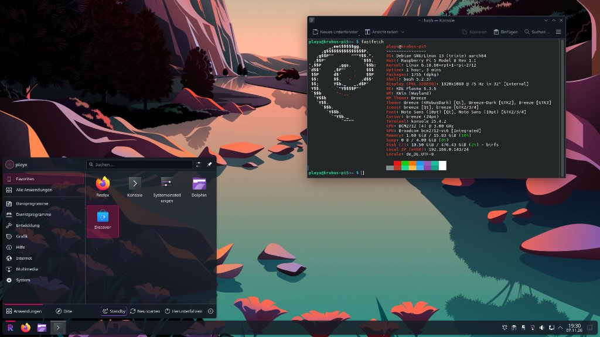

# 🍓 KRubus — High-Performance KDE Plasma 6 (Wayland) OS for Raspberry Pi 5 & CM5

<div align="center">

[](https://github.com/GamingTux/KRubus/releases)
[](https://www.raspberrypi.com/products/raspberry-pi-5/)
[-1d99f3?logo=kde&logoColor=white)](https://kde.org/plasma-desktop/)
[-d70a53?logo=debian&logoColor=white)](https://www.debian.org)
[-22c55e?logo=linux)](https://btrfs.readthedocs.io/)
[-orange)](https://github.com/GamingTux/KRubus)
[](https://github.com/GamingTux/KRubus)

**A modern, ultra-responsive, microarchitecture-optimized Linux distribution delivering a full-featured desktop experience on Broadcom BCM2712 hardware.**

[Download Release Image](https://github.com/GamingTux/KRubus/releases) • [Browse APT Repository](https://gamingtux.github.io/KRubus/) • [Features](#-key-features) • [Installation Guide](#-installation)

</div>

---

<div align="center">
  
  <p><em>KRubus running native KDE Plasma 6 on Wayland with the signature KRubus Dark Theme, customized vector launcher, and Fastfetch hardware readout.</em></p>
</div>

---

## 📖 Overview

**KRubus** (*K*DE + *Rubus idaeus*) is an operating system crafted specifically for the **Raspberry Pi 5, Raspberry Pi 500, and Compute Module 5 (CM5)**. Built atop **Raspberry Pi OS / Debian 13 (Trixie) ARM64**, it replaces traditional lightweight compromises with a fluid, modern **KDE Plasma 6 (Wayland)** desktop environment backed by end-to-end hardware acceleration, a custom **1000 Hz low-latency kernel**, transparent **Btrfs ZSTD compression**, instant **userspace sleep/standby**, and an exclusive **Cortex-A76 microarchitecture-optimized APT repository**.

Booting to a fully interactive desktop in **under 5 seconds**, KRubus delivers workstation-grade responsiveness on a credit-card-sized single-board computer.

---

## ⚡ Key Features

### 🖥️ Pure Wayland KDE Plasma 6
* **Smooth 60/75 Hz Compositing:** Native Wayland session powered by KWin and the Broadcom VideoCore VII (V3D 7.1) driver with direct DMA-BUF zero-copy buffer sharing.
* **Handcrafted KRubus Dark Theme:** Custom obsidian & midnight slate color palette (`#0d1117` / `#161c26`) paired with electric raspberry (`#e30b5d`), violet (`#8b45c9`), and Plasma blue (`#1d99f3`) accents derived from the official KRubus insignia.
* **Vector Launcher Branding:** Scalable, transparent application launcher icon pre-configured directly on the primary panel.
* **Snappy UI Response:** Tuned animation durations (`0.5x`), subpixel RGB font rendering, and zero-latency input delivery.

### 🚀 Dedicated Cortex-A76 APT Repository (`+pi5`)
* Over **390 core packages** (including Qt6, KDE Frameworks 6, KWin, Mesa, PipeWire, GStreamer, and FFmpeg) natively built and continuously updated specifically for the **ARMv8.2-A Cortex-A76** core.
* **Compiler Flags:** Compiled with `-mcpu=cortex-a76+crypto -O3 -flto=auto -ftree-vectorize -floop-interchange -floop-nest-optimize -mearly-ra=all` and exact BCM2712 cache geometry parameters (64 KB L1, 512 KB L2).
* **Stripped Bloat:** Legacy Armv7/Cortex-A53 errata workarounds and PAC/BTI penalties completely removed for maximum instructions per cycle (IPC).
* **Web Catalog:** Search and inspect every package in the live repository catalog at [gamingtux.github.io/KRubus](https://gamingtux.github.io/KRubus/).

### 💾 Btrfs Root Filesystem with ZSTD Compression
* **Transparent Compression (`compress=zstd:1`):** Reduces flash write wear by ~40%, doubles effective storage capacity, and significantly boosts read speeds from MicroSD, eMMC, and NVMe drives.
* **Subvolume Architecture:** Isolated `@` (root) and `@home` (user data) layout ready for instantaneous Btrfs snapshots and rollbacks.
* **Btrfs Async Discard:** Native TRIM support maintaining NVMe and flash drive longevity without periodic performance hiccups.

### 💤 Instant Sleep & Standby (`rpi-suspend`)
* **Hardware Sleep Simulation:** Bridges the platform lack of ACPI S3 by leveraging cgroups v2 process freezing, single-core CPU parking, and DRM display blanking.
* **Sub-Millisecond Wakeup:** Instant resume via keyboard, mouse, or hardware power button.
* **Clamshell Support:** Native laptop lid detection for portable Raspberry Pi 5 & CM5 shells (uConsole, CrowView, Argon ONE UP).

### 🔋 Hardware Power Profiles Daemon (`rpi-power-profiles`)
* Event-driven, 0% idle overhead D-Bus daemon implementing `org.freedesktop.UPower.PowerProfiles`.
* Controlled natively through KDE Plasma's battery & power settings applet:
  * **Balanced (Default):** Dynamic 0.5 ms ultra-low-latency `schedutil` governor, power-efficient workqueues, balanced PCIe ASPM.
  * **Performance:** Maximum CPU clock frequency governor, unconstrained PCIe ASPM, maximum throughput.
  * **Power Saver:** Frequency throttling, aggressive power saving, and automated background Wi-Fi powersave.

### 🛡️ Low-Latency Dual-Kernel & System Tuning
* **1000 Hz Timer Frequency:** Real-time desktop responsiveness with `CONFIG_HZ_1000=y` and `16K` kernel memory pages.
* **ZRAM with ZSTD Compression:** Dynamic compressed swap (`min(RAM, 8192 MB)`) using fast `zstd` compression, extending 2 GB / 4 GB / 8 GB models up to ~12–24 GB effective memory capacity.
* **EarlyOOM Desktop Protection:** Guarantees that KDE Plasma, Wayland compositors, and audio daemons are never terminated during heavy multitasking memory pressure.
* **TCP BBR & Network Stack Optimization:** TCP BBR congestion control, fastopen, enlarged socket buffer ceilings, and local DNS caching via systemd-resolved.
* **Multi-Rate PipeWire Engine:** Supports native hardware sample rates (44.1 kHz, 48 kHz, 88.2 kHz, 96 kHz) without forced resampler overhead.

### 🌐 Pre-Tuned Firefox Browser
* **RAM-Only Cache (Zero Flash Wear):** Disk caching disabled in favor of an enlarged 256 MB ZRAM memory cache (`browser.cache.memory.capacity = 262144`) for instant back/forward navigation.
* **Automatic Tab Sleeping:** Memory-efficient background tab suspension (`browser.tabs.unloadOnLowMemory`) preventing out-of-memory stalls.
* **Privacy & Decrapification:** Telemetry, Mozilla studies, Pocket, and sponsored new-tab tiles completely disabled out of the box.
* **Native Wayland Zero-Copy:** Full WebRender and DMA-BUF hardware acceleration enabled.

---

## 📥 Installation

### Method 1: Flash Pre-Built Image (Recommended)

1. Download the latest release image (`krubus-pi5-*.img.xz`) from [GitHub Releases](https://github.com/GamingTux/KRubus/releases).
2. Write the image to your NVMe SSD, eMMC, or MicroSD card using [Raspberry Pi Imager](https://www.raspberrypi.com/software/) or [BalenaEtcher](https://etcher.balena.io/):
   * *In Raspberry Pi Imager:* Select **Use custom** and choose the downloaded `.img.xz` file.
3. Insert the media into your Raspberry Pi 5 / 500 / CM5 and power on.
4. The first-boot wizard will guide you through setting up your user account, keyboard layout, and Wi-Fi connection.

---

### Method 2: Add KRubus Repository to an Existing Debian 13 / Raspberry Pi OS Install

If you already have a running Debian 13 (Trixie) ARM64 installation on a Raspberry Pi 5:

```bash
# 1. Install KRubus GPG Keyring
sudo mkdir -p /etc/apt/keyrings
sudo curl -fsSL https://gamingtux.github.io/KRubus/krubus.gpg -o /etc/apt/keyrings/krubus.gpg

# 2. Add KRubus APT Repository
echo "deb [arch=arm64 signed-by=/etc/apt/keyrings/krubus.gpg] https://gamingtux.github.io/KRubus trixie main" | sudo tee /etc/apt/sources.list.d/krubus.list

# 3. Prioritize KRubus (+pi5) Packages
cat << 'EOF' | sudo tee /etc/apt/preferences.d/krubus-pi5.pref
Package: *
Pin: origin "gamingtux.github.io"
Pin-Priority: 1001
EOF

# 4. Refresh Package Lists and Upgrade
sudo apt update && sudo apt full-upgrade -y

# 5. Install the KRubus Desktop Metapackage
sudo apt install -y krubus-desktop
```

---

## 📦 Metapackage Architecture

KRubus follows a clean modular metapackage design, ensuring rolling updates automatically reach your installation via `sudo apt upgrade`:

| Package | Version | Description |
| :--- | :--- | :--- |
| **[`krubus-desktop`](./packages/krubus-desktop)** | `1.0.0` | Flagship metapackage pulling in KDE Plasma 6, SDDM, KWin Wayland, Dolphin, Konsole, and all system tunings. |
| **[`krubus-default-settings`](./packages/krubus-default-settings)** | `1.0.8` | Core system configuration: KRubus Dark theme, vector icons, ZRAM zstd, sysctl, EarlyOOM rules, PipeWire multi-rate, and Firefox policies. |
| **[`rpi-power-profiles`](./packages/rpi-power-profiles)** | `1.0.2` | Event-driven D-Bus hardware power profiles daemon connecting KDE PowerDevil with BCM2712 CPU governors and PCIe ASPM. |
| **[`rpi-suspend`](./packages/rpi-suspend)** | `1.5.2` | Standby and sleep manager enabling instant `<1 ms` interrupt wakeup on Raspberry Pi 4/5 hardware. |
| **[`krubus-kernel-hook`](./packages/krubus-kernel-hook)** | `1.0.0` | Kernel packaging hook maintaining the 1000 Hz dual-kernel configuration in `/boot/firmware/kernel_2712.img`. |

---

## 🛠️ Performance & Compiler Configuration

All packages in the KRubus APT repository are compiled with uncompromising, hardware-specific flags tailored exclusively for the BCM2712 SoC:

```bash
# Architecture & Cache Geometry
-mcpu=cortex-a76+crypto -mtune=cortex-a76 -mno-fix-cortex-a53-835769 -mno-fix-cortex-a53-843419 \
-mbranch-protection=none -mno-outline-atomics -mearly-ra=all \
--param l1-cache-size=64 --param l1-cache-line-size=64 --param l2-cache-size=512

# Optimization & Code Generation
-O3 -ftree-vectorize -fvect-cost-model=dynamic -fomit-frame-pointer -fno-semantic-interposition \
-fno-math-errno -fno-trapping-math -ffp-contract=fast -fprefetch-loop-arrays -floop-interchange \
-floop-unroll-and-jam -fpeel-loops -funroll-loops -ftracer -fgraphite-identity -floop-nest-optimize -g0

# Link-Time Optimization & 16K Page Alignments
-flto=auto -ffat-lto-objects -fuse-linker-plugin -fdevirtualize-at-ltrans \
-Wl,-O3 -Wl,--as-needed -Wl,--hash-style=gnu -Wl,-z,max-page-size=16384 -Wl,-z,common-page-size=16384
```

---

## 📂 Repository Structure

* [`packages.txt`](./packages.txt) — Comprehensive list of all 390+ upstream Debian source packages built with Cortex-A76 `-O3 + LTO` optimization.
* [`packages/`](./packages/) — Native KRubus deb packages (`krubus-desktop`, `krubus-default-settings`, `rpi-power-profiles`, `rpi-suspend`, `krubus-kernel-hook`).
* [`build-repo.sh`](./build-repo.sh) — Autonomous delta APT repository builder with self-healing LTO fallbacks, time budgeting, and GPG signing.
* [`generate-repo-index.py`](./generate-repo-index.py) — Static site generator producing the searchable GitHub Pages catalog.
* [`sync-rpi-suspend.sh`](./sync-rpi-suspend.sh) — Automated upstream sync script for `rpi-suspend`.
* [`pi-gen/`](./pi-gen/) — Official Raspberry Pi image generation pipeline configured with Btrfs rootfs and KDE Plasma stage modules.
* [`.github/workflows/`](./.github/workflows/) — Automated CI/CD workflows for APT repository updates and automated `.img.xz` release builds.

---

## 🤝 Contributing & License

Contributions, hardware benchmarks, and feedback are warmly welcomed! Please feel free to open an issue or pull request.

* **Distribution:** Open-source software released under the terms of the **GPL-2.0 / LGPL-2.1** and Debian licenses.
* **Project Maintainer:** [GamingTux](https://github.com/GamingTux)
* **Website / APT Repo:** [https://gamingtux.github.io/KRubus/](https://gamingtux.github.io/KRubus/)
